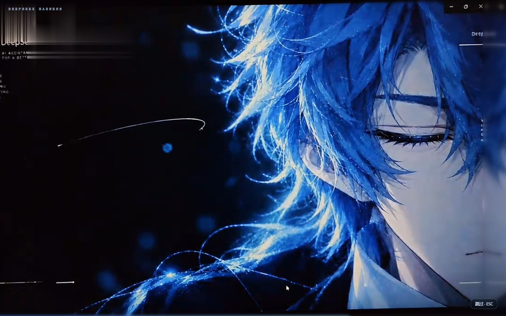
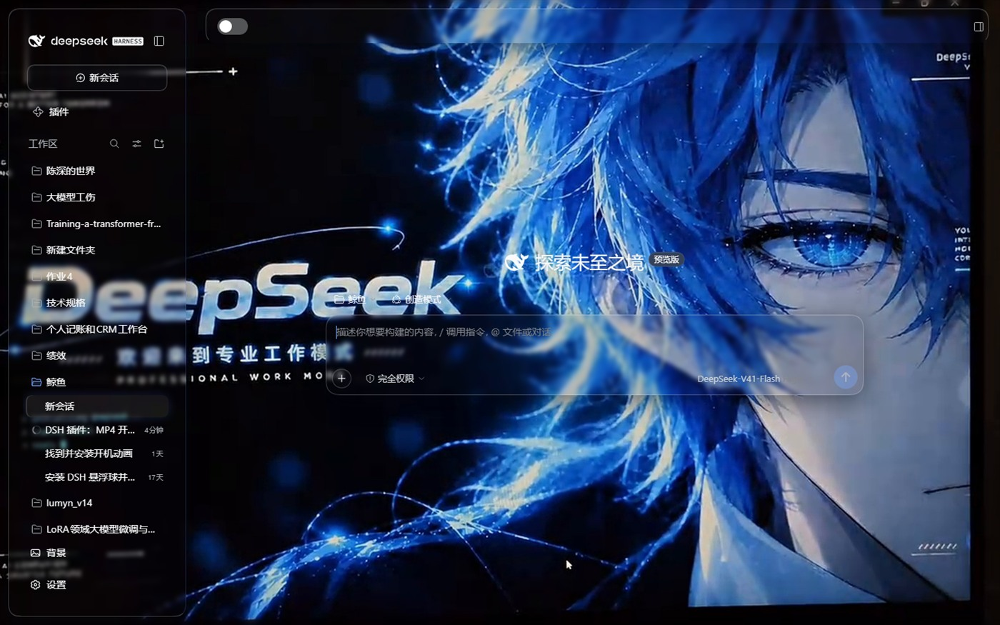
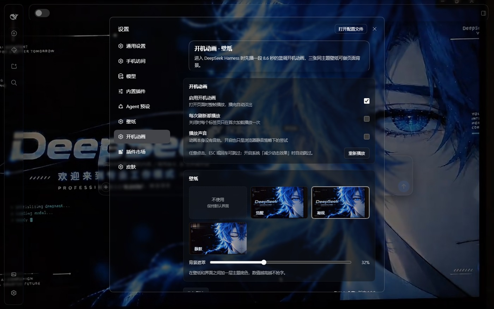

# DSH Boot Animation & Wallpapers (Male Version)

[](LICENSE)

> **One line: install it, open DeepSeek Harness, watch an 8.6s DeepSeek-blue boot animation (skippable), then keep one of three matching wallpapers behind the UI.**

A fully local DeepSeek Harness Web plugin. The Host half serves the bundled media over one same-origin route; the Client half plays the full-frame overlay, paints the wallpaper layer at `z-index:-1`, and adds a settings page. No network access, no user-file reads, no host config writes.



## Features

- **Boot animation** — full-frame 8.6s 1080p clip on load, fades out when it ends.
  - Skip with a click, `ESC` or `Enter`; automatically skipped under `prefers-reduced-motion`.
  - Plays once per tab by default; a setting makes it play on every reload.
- **Three wallpapers** — `Awake` / `Gaze` / `Silent`, frame-stills from the same animation.
- **Background veil** — 0–85%, tinted with the current theme base colour so text stays readable in light and dark themes.
- **No telemetry** — preferences live in `localStorage`.




## Install

```bash
dsh plugin --profile web add github:Apple-TWININGS/DEEPSEEK-HARNESS-Boot-Animation-Male-Version
```

Or install a local checkout by directory:

```bash
dsh plugin --profile web add "D:\path\to\DEEPSEEK-HARNESS-Boot-Animation-Male-Version"
```

Reload the page to see the boot animation. Settings live under **Settings → Boot animation**.

> If the plugin does not show up, append `"dsh-boot-animation-male"` to `dsh.profile.bundles` in the profile's
> `package.json` (or enable it under **Settings → Plugins**). Replace `web` with your profile name if different.

> The npm package `dsh-boot-animation-male` is not published yet. Once it is, the command becomes
> `dsh plugin --profile web add dsh-boot-animation-male`, which is also what makes it appear in the in-app plugin store.

## Settings

| Option | Default | Notes |
| --- | --- | --- |
| Enable boot animation | on | Off: no overlay on load |
| Play on every reload | off | Off: first load of each tab only |
| Play with sound | off | The clip has no audio track |
| Play again | — | Replay immediately |
| Wallpaper | Awake | `None` keeps the default UI |
| Background veil | 32% | Theme base colour between wallpaper and UI |

Stored under `localStorage` keys `dsh-boot-animation-male:settings:v1` and `dsh-boot-animation-male:played:v1` (sessionStorage).

## Compatibility

- DSH `0.2.0-rc.2`, Web front end (`dsh web` or the desktop app).
- Web platform only; the Host half silently skips route registration where no `webServer` exists, so headless/TUI profiles still boot.
- Chrome / Edge / Firefox current versions; Safari needs H.264 MP4 support.
- 4.4 MB video + ~0.9 MB of wallpapers, fetched on first load, then cached via `Cache-Control` + `ETag`.

## Permissions and risks

- One prefix route `GET|HEAD /dsh-boot-animation-male/*` serving only whitelisted extensions from the package's `assets/`; `..`, backslashes and path escapes are rejected.
- `Range` support for seeking/streaming and `ETag` for 304 reuse. No file writes, no outbound requests, no user-directory reads.
- Only one background / boot plugin should be enabled at a time: wallpaper layers all sit at `z-index:-1`, so the last one installed wins.

## Uninstall

```bash
dsh plugin --profile web remove dsh-boot-animation-male
```

## Credits

Artwork produced by **Apple-TWININGS**, released under MIT with this repository.

## License

[MIT](LICENSE) © 2026 Apple-TWININGS
