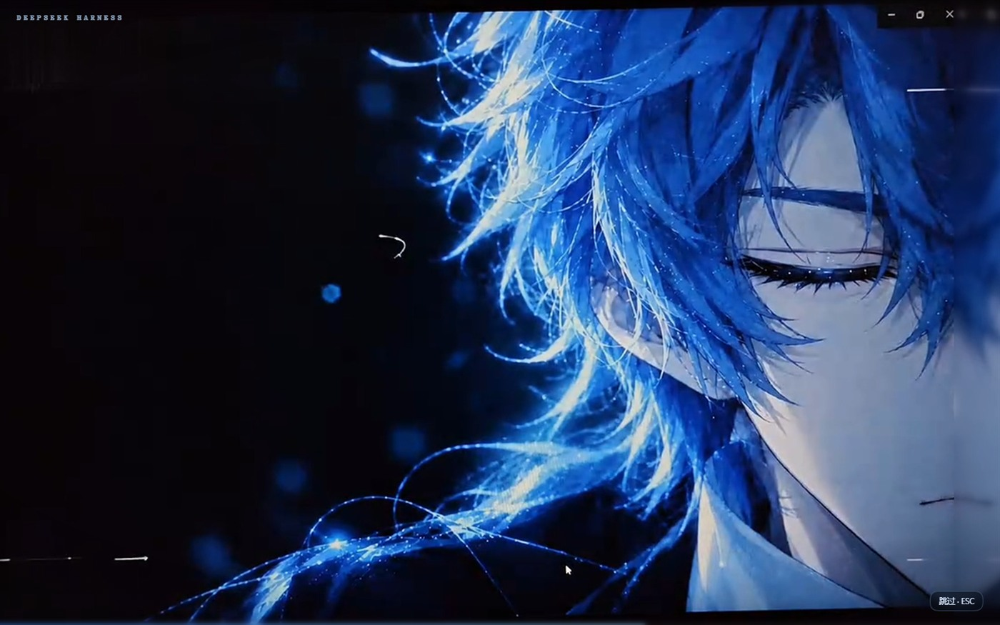
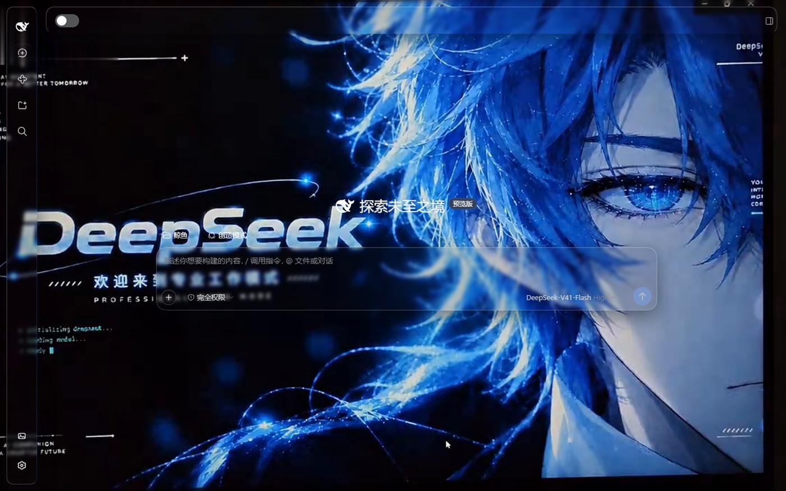
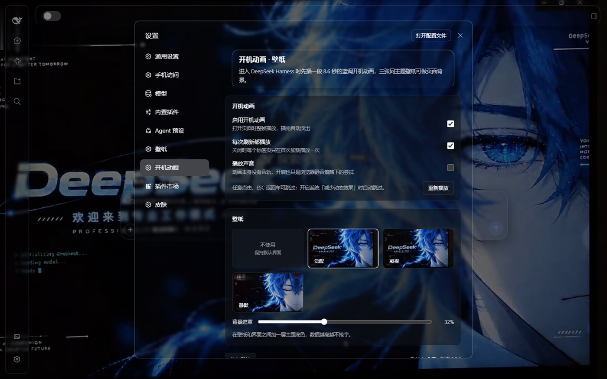

# DSH 开机动画 · 壁纸（男版）

[](https://dsh-plugin.org/plugins/Apple-TWININGS/DEEPSEEK-HARNESS-Boot-Animation-Male-Version)
[](LICENSE)
[](https://github.com/deepseek-ai/deepseek-harness)

> **一句话：装完打开 DeepSeek Harness，先看 8.6 秒的蓝调开机动画（可跳过），再回到一张同主题的深蓝壁纸。**

一个纯本地、不联网的 DSH Web 插件：把 `dsh-boot-clips` 里的 MP4 做成开机动画，并附带三张同主题壁纸。
宿主半（Node）只负责把包内媒体用同源路由发出去；浏览器半负责浮层播放、壁纸层和设置页。



## 它做了什么

- **开机动画**：打开页面时整帧播放 8.6 秒 1080p 的蓝调开机动画，播完自动淡出。
  - 点击画面、按 `ESC` 或回车即可跳过；
  - 系统开启「减少动态效果」时自动跳过；
  - 默认每次打开 / 刷新页面都播放，设置里可改成「每个标签页只播一次」。
- **三张壁纸**：`觉醒` / `凝视` / `静默`，从同一段动画的定格帧里出，色调和动画一致。
- **背景遮罩**：0–85% 可调，遮罩取当前主题的底色，深色 / 浅色主题下都不抢字。
- **全部本地**：偏好存在 `localStorage`，不上传、不联网、不读取用户目录。




## 安装

当前推荐从 GitHub 源码安装（`dsh` 需在 PATH 里）：

```bash
dsh plugin --profile web add github:Apple-TWININGS/DEEPSEEK-HARNESS-Boot-Animation-Male-Version
```

本地已经 clone 的话，也可以直接装目录：

```bash
dsh plugin --profile web add "D:\path\to\DEEPSEEK-HARNESS-Boot-Animation-Male-Version"
```

装完刷新页面即可看到开机动画；设置页在 **设置 → 开机动画**。

> 如果插件列表里没出现，把 `"dsh-boot-animation-male"` 加到该 profile `package.json` 的 `dsh.profile.bundles`
> （或直接在 **设置 → 插件** 里启用）。装到别的 profile 时把 `web` 换成对应名字。

> npm 包（`dsh-boot-animation-male`）尚未发布，发布后安装命令会改为
> `dsh plugin --profile web add dsh-boot-animation-male`，届时才会出现在 DSH 内的「插件市场 / 插件中心」。

## 使用

打开 **设置（侧栏最下方）→ 开机动画**：

| 选项 | 默认 | 说明 |
| --- | --- | --- |
| 启用开机动画 | 开 | 关掉后刷新不再播放 |
| 每次刷新都播放 | 开 | 关时每个标签页只在首次加载播放一次 |
| 播放声音 | 关 | 动画本身没有音轨，开启只是让浏览器尝试非静音自动播放 |
| 重新播放 | — | 立刻重播一次，方便预览 |
| 壁纸 | 觉醒 | 可选「不使用」保持原界面 |
| 背景遮罩 | 32% | 壁纸与界面之间的主题底色浓度 |

设置写在 `localStorage` 的两个键里，手动清理即可恢复默认：

```text
dsh-boot-animation-male:settings:v1
dsh-boot-animation-male:played:v1   # 本标签页是否已播过（sessionStorage）
```

## 兼容性

- **DSH**：`0.2.0-rc.2`（Web 端，`dsh web` 或桌面端）实测通过；
- **平台**：只有 Web 平台有 UI 半（`dsh.client.platform = "web"`），headless / TUI 里宿主半会静默不注册路由，不影响启动；
- **浏览器**：Chrome / Edge / Firefox 新版；Safari 需要支持 H.264 MP4；
- **资源体积**：`assets/boot.mp4` 4.4 MB + 三张壁纸约 0.9 MB，只在首次打开时拉取，之后走 `Cache-Control` + `ETag`。

## 权限与风险

- 宿主半只注册一条前缀路由 `GET|HEAD /dsh-boot-animation-male/*`，只发送包内 `assets/` 下的白名单扩展名文件，拒绝 `..`、反斜杠和目录逃逸；
- 支持 `Range`（视频边下边播）与 `ETag`（304 复用），不写任何文件、不访问外网、不读取用户目录；
- 不修改任何宿主配置；所有偏好都留在浏览器 `localStorage`；
- 与其它背景 / 开机动画插件**同时只开一个**：壁纸层都是 `z-index:-1`，后挂的会盖住先挂的；开机动画同理。

## 卸载

```bash
dsh plugin --profile web remove dsh-boot-animation-male
```

或在 **设置 → 插件** 里关掉 / 卸载本 bundle。

## 素材

- 动画与三张壁纸由 **Apple-TWININGS** 制作，随本仓库以 MIT 许可发布；原始剪辑留在 `dsh-boot-clips/`（不入包）。
- `静默` 取自动画收尾的闭目帧；`觉醒`、`凝视` 取自睁眼定格帧。

## 目录结构

```text
.
├── index.js              # 宿主半：同源媒体路由（Range / ETag / 穿越防护）
├── client.js             # 浏览器半：开机动画浮层 + 壁纸层 + 设置页
├── cordis.patch.yml      # bundle 补丁：插入一行 boot-animation-male
├── package.json          # dsh.bundle.patch + dsh.client(platform=web)
├── icon.svg              # 插件管理页图标
├── locale/               # 插件显示标题 / 描述（en、zh）
├── assets/
│   ├── boot.mp4          # 8.6s 开机动画
│   ├── wallpapers/*.jpg  # 1920×1080 壁纸
│   └── thumbs/*.jpg      # 设置页缩略图 480×270
└── docs/screenshots/1.0.1/  # README 截图（收起侧边栏）
```

## English

A local-only DeepSeek Harness Web plugin: an 8.6-second blue-toned boot animation (skippable) plus three matching wallpapers, with a settings page under **Settings → Boot animation**. See [README.en.md](README.en.md).

## 许可

[MIT](LICENSE) © 2026 Apple-TWININGS
